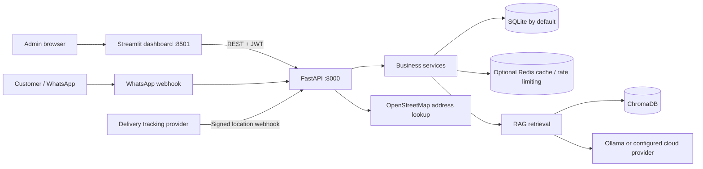

# Millet Milk Sales AI

An AI-assisted operations system for a millet milk business. It combines a FastAPI backend, a Streamlit administration dashboard, SQLAlchemy persistence, inventory/order workflows, a retrieval-augmented knowledge assistant, and optional WhatsApp and LLM integrations.

## Architecture



### Main layers

- `app/main.py` creates the FastAPI application and registers API routers.
- `app/api/` contains HTTP endpoints and request/response handling.
- `app/schemas/` defines Pydantic request validation and response contracts.
- `app/services/` implements order, product, inventory, customer, AI, cache, and tracking operations.
- `app/database/models.py` contains SQLAlchemy entities. `app/database/connection.py` creates the engine/session and initializes local tables/admin bootstrap.
- `dashboard/main.py` and `dashboard/pages/` provide the Streamlit admin UI. `dashboard/api_client.py` calls the backend and attaches the session's JWT.
- `migrations/` contains Alembic database migrations.
- `knowledge_base/` contains RAG source material; `data/chroma_db/` contains the local Chroma persistence data.
- `tests/` contains automated checks for API and business workflows.

## Requirements

- Windows, macOS, or Linux
- Python 3.11 or newer recommended
- Internet access for package installation, OpenStreetMap address lookup, and any remote integrations
- Optional: Ollama for local LLM features; Redis if enabling Redis-backed cache/rate limiting
- Optional: an external delivery tracking provider that can POST webhook events to this API

## Setup on Windows PowerShell

Run commands from the repository root:

```powershell
py -m venv .venv
.\.venv\Scripts\Activate.ps1
python -m pip install --upgrade pip
pip install -r requirements.txt
```

Create `.env` only if it does not already exist. Keep an existing file and edit the needed settings rather than replacing it:

```powershell
if (!(Test-Path .env)) { Copy-Item .env.example .env }
```

If PowerShell prevents virtual-environment activation, allow activation for the current terminal only or run the virtual-environment Python directly:

```powershell
.\.venv\Scripts\python.exe -m pip install -r requirements.txt
```

Review `.env` before starting the application. Do not commit `.env` or paste secrets into source files. At minimum:

- Set a strong, unique `JWT_SECRET_KEY`.
- On first startup, the app creates a development bootstrap admin only if the database has no users. It does not overwrite an existing account. For production, create a controlled admin through the protected signup flow and replace/remove development defaults before deployment.
- Set `ADMIN_SIGNUP_KEY` to a unique random value to enable admin signup. Signup is disabled when it is empty; provide the value only to approved administrators.
- Set `TRACKING_WEBHOOK_SECRET` to a different unique random value to accept delivery-provider updates.
- Set `REDIS_ENABLED=false` and `RATE_LIMIT_ENABLED=false` for local development unless Redis is running; add these as `NAME=value` lines in `.env` if they are absent.
- Configure WhatsApp and cloud LLM variables only when those integrations are used.

Generate strong development secrets with:

```powershell
python -c "import secrets; print(secrets.token_urlsafe(32))"
```

Use a different generated value for each secret. Add `API_BASE_URL=http://127.0.0.1:8000/api/v1` to `.env` if the dashboard should call a non-default API URL.

## Database

The default database is `sqlite:///./millet_milk.db`, relative to the working directory. On startup, the application ensures tables exist and creates the bootstrap admin only if the user table is empty.

Use Alembic when applying schema changes to an existing database:

```powershell
.\.venv\Scripts\alembic.exe upgrade head
```

The delivery-tracking migration adds nullable coordinates and timestamps to existing orders, preserving existing records.

## Run the application

Open two PowerShell terminals in the repository root and activate `.venv` in each.

Terminal 1, FastAPI:

```powershell
uvicorn app.main:app --reload
```

Terminal 2, Streamlit:

```powershell
streamlit run dashboard/main.py
```

Open:

- Dashboard: <http://localhost:8501>
- FastAPI health: <http://127.0.0.1:8000/health>
- Interactive API docs: <http://127.0.0.1:8000/docs>

The dashboard requires an admin login. Login can use the configured bootstrap account or an account created through the invite-key-protected signup form.

## Core workflows

### Administration and authentication

The dashboard obtains a JWT from `POST /api/v1/auth/login` and sends it as a bearer token. Write operations require an admin role. Signup is handled by `POST /api/v1/auth/signup`, uses `ADMIN_SIGNUP_KEY`, and requires a password of at least 12 characters. Never enable signup with a guessable invite key.

### Products and inventory

- Create products with ID, name, millet, size, price, and initial stock.
- Edit product details and deactivate products. Deactivation is a soft delete; it retains historical order references.
- Inventory is created with the product or on the first stock adjustment.
- Stock updates create movement records. Setting stock to zero retains the inventory row and its movement history.

### Orders and customers

- Register customers with name and phone; address is optional on the customer record.
- Create orders from registered customers and available products. The API calculates prices from product records and reserves inventory.
- Update order fulfillment and payment status. Cancelling an eligible order restores inventory and adds a stock movement.
- Customers with linked orders or user accounts cannot be deleted, protecting database references.

### Address pins and delivery tracking

For a home-delivery order, enter the house/flat number, street, locality, city, and six-digit PIN code. The dashboard queries OpenStreetMap Nominatim, displays candidates, and requires the operator to choose the one matching the actual home. Geocoding is best-effort: a PIN code and house number alone are not sufficient to guarantee a building-level match. Verify the map pin before placing the order.

OpenStreetMap's public Nominatim endpoint is rate-limited by the application and may not resolve every address. For production or high-volume address lookup, use a hosted geocoding service and follow its terms and usage limits.

The dashboard polls the order's latest rider location every five seconds. The external tracking provider must be configured to POST to:

```text
POST /api/v1/orders/{order_id}/tracking
X-Tracking-Token: <TRACKING_WEBHOOK_SECRET>
Content-Type: application/json
```

Payload example:

```json
{
  "event": "location",
  "latitude": 17.385044,
  "longitude": 78.486671,
  "recorded_at": "2026-11-13T10:15:00Z"
}
```

Supported events: `location`, `out_for_delivery`, and `delivered`. Timestamps must include a timezone. Older location updates and cancelled orders are rejected. A `delivered` event is accepted only when the order has a confirmed destination pin and the provider's coordinates are within 150 meters of that pin. Manual status changes cannot bypass this check. See [DELIVERY_TRACKING.md](DELIVERY_TRACKING.md) for the provider integration details.

### AI, RAG, and WhatsApp

AI and RAG endpoints are under `/api/v1/ai`, `/api/v1/rag`, `/api/v1/knowledge`, and `/api/v1/llm`. RAG uses the configured Chroma collection and embedding model. The default LLM provider is Ollama; cloud LLM settings are optional. WhatsApp webhook endpoints are under `/webhook/whatsapp` and require valid Meta webhook configuration for real traffic.

## API route groups

| Prefix | Purpose |
| --- | --- |
| `/api/v1/auth` | Admin login and invite-key signup |
| `/api/v1/products` | Product catalog and administration |
| `/api/v1/inventory` | Stock levels and movement history |
| `/api/v1/orders` | Orders, status/payment updates, geocoding, tracking webhook |
| `/api/v1/customers` | Customer records |
| `/api/v1/analytics` | Sales and business metrics |
| `/api/v1/ai`, `/api/v1/rag`, `/api/v1/knowledge`, `/api/v1/llm` | Assistant, retrieval, knowledge, and LLM gateway |
| `/webhook/whatsapp` | WhatsApp webhook integration |

## Tests and checks

Run the test suite from the repository root:

```powershell
pytest -q
```

Compile application modules without running tests:

```powershell
python -m compileall app dashboard
```

When a test or API call fails, check the FastAPI and Streamlit terminal output, the `/health` endpoint, `.env` configuration, and the API response body.

## Security and operations notes

- `.env` is local configuration and must remain private. `.env.example` is a template, not a secrets file.
- Use HTTPS for any deployed dashboard, API, or provider webhook. Keep the tracking webhook secret out of URLs and payloads.
- Rotate the JWT, signup, tracking, and third-party credentials if exposed.
- The default setup is development-oriented. Configure production-grade database, secrets management, rate limiting, backups, logging, and external service usage limits before deployment.
- A provider-neutral tracking webhook is implemented, but actual rider tracking requires a provider account/configuration that sends valid location events.
